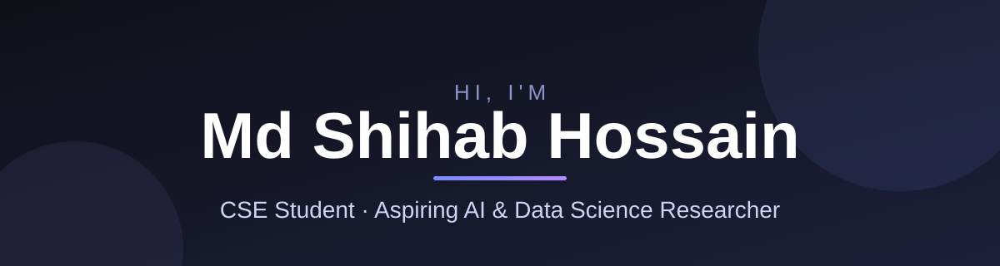

 

*Learning, building, and exploring research one step at a time.*

---

## 👋 About me

I'm a **Computer Science and Engineering student** at Bangladesh University of Business and Technology (BUBT), interested in software development, Artificial Intelligence, Data Science, and academic research.

I use GitHub to build practical projects, strengthen my programming skills, and document my learning journey. I'm open to learning, research collaboration, and suitable internship opportunities.

## 🔬 Research interests

| | Area |
| --- | --- |
| 🤖 | Artificial Intelligence and Machine Learning |
| 📊 | Data Science and Data Analysis |
| 🌍 | AI applications in real-world problems |
| 📚 | Research tools and academic computing |

## 🛠️ Tech stack

**Core concepts:** Object-Oriented Programming · Database Systems · Data Structures

## 🚀 Featured projects

<table>
  <tr>
    <td width="33%" valign="top">
      <h3>📑 Research Paper Organizer</h3>
      
A Python desktop app for organizing research notes with SQLite storage, Markdown editing, live preview, and search.

      
<b>Stack:</b> Python · PyQt6 · SQLite

      
<i>Status: prototype / in development</i>

      
<a href="https://github.com/mdshihabhossain726/research-paper-organizer">View project →</a>

    </td>
    <td width="33%" valign="top">
      <h3>🎮 Ein Neues Leben</h3>
      
A visual novel that combines storytelling with German language learning, with character dialogue, interactive choices, learning screens, and save/load.

      
<b>Stack:</b> Ren'Py · Python

      
<i>Status: in development</i>

      
<a href="https://github.com/mdshihabhossain726/Ein-Neues-Leben-Portfolio">View portfolio →</a>

    </td>
    <td width="33%" valign="top">
      <h3>💬 Shihu AI</h3>
      
A web-based AI chat assistant with accounts, saved conversations, and a clean, focused interface.

      
<b>Hosted on:</b> Render

      
<i>Status: live</i>

      
<a href="https://shihu-ai.onrender.com/chat-ui">Try it →</a> · <a href="https://github.com/mdshihabhossain726/shihu-ai-showcase">Docs →</a>

    </td>
  </tr>
</table>

## 🎯 Current focus

- Improving programming and problem-solving skills
- Building practical software projects
- Exploring AI and Data Science research papers
- Learning database design and software engineering

## 🤝 Let's connect

- 🌐 **Portfolio:** [mdshihabhossain726.github.io](https://mdshihabhossain726.github.io/)
- 💼 **LinkedIn:** [Md Shihab Hossain](https://www.linkedin.com/in/mdshihabhossain726/)
- ✉️ **Email:** [mdshihabhossain726@gmail.com](mailto:mdshihabhossain726@gmail.com)

---

⭐ Thanks for stopping by!

